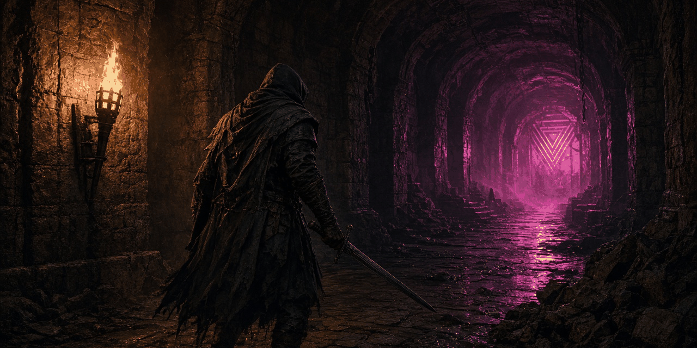

<p align="center">
  
</p>
<p align="center"><em>A synthwave combat calculator for Dark and Darker. Know your numbers before the dungeon.</em></p>

# Dark and Calculator

A synthwave-themed combat calculator for **Dark and Darker**, built with React, TypeScript, and Vite.


## Credits

- **Original calculator** by [AntonMarkham](https://github.com/AntonMarkham/dad_calculator) — the weapon database, damage formulas, and timing data were ported from the original HTML/CSS/JS implementation.
- **This fork** adds a modern React/TypeScript stack, synthwave '84 aesthetic, expanded D&D systems (spells, buffs, status effects, enemy types), and a modular UI.

## Features

- **40+ weapons** across Swords, Maces, Daggers, Polearms, Axes, Bows, Crossbows, Firearms, and Magic Staves
- **Rarity-based damage interpolation** (Poor → Unique)
- **Full combat timing**: windup, hit, hitstop, recover, alt-recover, finish phases
- **Action speed scaling**, combo multipliers, hit location multipliers
- **PDR/MDR armor reduction**, flat reduction, block/shield %
- **Per-swing breakdown** with HP bar visualization
- **TTK summary cards** (hits to kill, DPS, windup time)
- **Spells & Buffs**: 10 spells across Arcane/Divine/Nature/Shadow schools, 8 status effects
- **14 enemy presets** with weaknesses and resistances
- **Synthwave '84 theme**: deep purples, neon glows, grid backgrounds, Orbitron + Rajdhani fonts

## Development

```bash
npm install
npm run dev
```

## Build

```bash
npm run build
```

Outputs static files to `dist/` — ready for GitHub Pages, Netlify, Vercel, etc.

## License

MIT — see [LICENSE](LICENSE) for details.

## Acknowledgments

- Weapon data and formulas from [AntonMarkham/dad_calculator](https://github.com/AntonMarkham/dad_calculator)
- Dark and Darker is a trademark of IRONMACE Co., Ltd.

---

## ☕ Support the Developer

If this project saved you time, solved a problem, or just made your day a little more neon, you can fuel the next one:

[](https://buymeacoffee.com/synthalorian)

---

<p align="center">
  <br>
  <sub>Built by <a href="https://github.com/synthalorian">the synthalorian</a></sub>
  <br><sub>AI-assisted art: the banner image at the top of this README was made with AI image tools. The synthalorian sprite is code-drawn pixel art.</sub>
</p>
